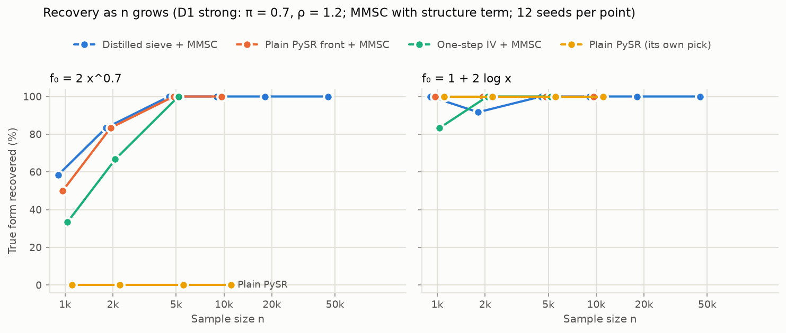
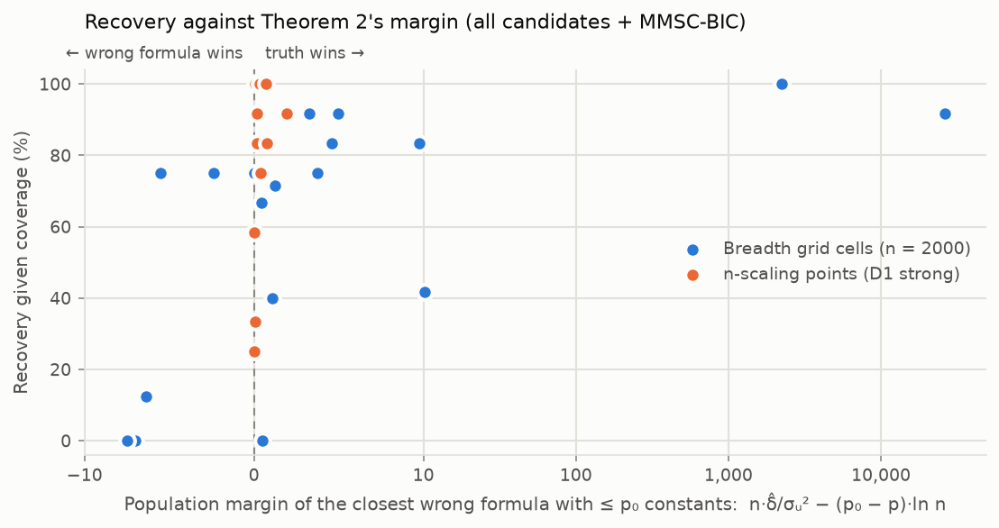

# Phase 4 results

Generated by `experiments/phase4_report.py` from 528 analysed runs (0 analysis errors): breadth 288, nscale 144, nomax 48, cf 48. 12 seeds per cell. Recovery = the selected formula has the true form (§8.1); rates show 95% Wilson intervals. Errors are RMS(f̂ − f₀) in units of the in-sample sd of f₀. Paired comparisons (+a / −b) count runs recovered only by the row's method / only by the reference, with exact McNemar p.

## 1. Breadth: five laws × five designs (n = 2000)

| Design | Law | Plain PySR, own pick | One-step + MMSC | Distilled + MMSC | Library path + MMSC | **All pooled + MMSC** | Any candidate has the true form | Pooled: in-sample error | Pooled: extrapolation error | Sieve curve error |
|---|---|---|---|---|---|---|---|---|---|---|
| D1 confounding | 1 + 2 log x | 100% | 83% | 100% | 100% | **92%** | 100% | 0.020 | 0.045 | 0.032 |
| D1 confounding | 2 x^0.7 | 100% | 83% | 83% | 0% | **83%** | 100% | 0.014 | 0.075 | 0.072 |
| D1 confounding | x - 0.8 max(x - 1.5, 0) | 0% | 0% | 0% | 0% | **0%** | 8% | 0.120 | 0.570 | 0.221 |
| D1 confounding | 3x / (1 + x) | 0% | 0% | 50% | 0% | **42%** | 58% | 0.098 | 0.314 | 0.138 |
| D1 confounding | 1.5 x1^0.3 x2^0.5 | 58% | 83% | 75% | – | **75%** | 100% | 0.025 | 0.577 | 0.112 |
| D2 heterosk. first stage | 1 + 2 log x | 100% | 100% | 100% | 100% | **100%** | 100% | 0.020 | 0.027 | 0.037 |
| D2 heterosk. first stage | 2 x^0.7 | 100% | 92% | 100% | 0% | **92%** | 100% | 0.006 | 0.020 | 0.103 |
| D2 heterosk. first stage | x - 0.8 max(x - 1.5, 0) | 0% | 8% | 0% | 0% | **0%** | 33% | 0.054 | 0.117 | 0.228 |
| D2 heterosk. first stage | 3x / (1 + x) | 0% | 25% | 25% | 0% | **25%** | 33% | 0.186 | 0.278 | 0.182 |
| D2 heterosk. first stage | 1.5 x1^0.3 x2^0.5 | 100% | 83% | 83% | – | **92%** | 100% | 0.017 | 0.440 | 0.157 |
| D3 simultaneity | 1 + 2 log x | 0% | 83% | 83% | 92% | **83%** | 100% | 0.020 | 0.034 | 0.050 |
| D3 simultaneity | 2 x^0.7 | 0% | 25% | 25% | 0% | **8%** | 67% | 0.046 | 0.680 | 0.081 |
| D3 simultaneity | x - 0.8 max(x - 1.5, 0) | 0% | 0% | 0% | 0% | **0%** | 0% | 0.128 | 2.222 | 0.151 |
| D3 simultaneity | 3x / (1 + x) | 0% | 17% | 8% | 0% | **17%** | 42% | 0.062 | 0.568 | 0.102 |
| D4 discrete Z (J = 4) | 1 + 2 log x | 100% | 92% | 75% | 75% | **75%** | 100% | 0.018 | 0.028 | 0.051 |
| D4 discrete Z (J = 4) | 2 x^0.7 | 100% | 42% | 75% | 0% | **42%** | 100% | 0.208 | 1.934 | 0.124 |
| D4 discrete Z (J = 4) | x - 0.8 max(x - 1.5, 0) | 0% | 0% | 0% | 0% | **0%** | 0% | 0.271 | 1.984 | 0.302 |
| D4 discrete Z (J = 4) | 3x / (1 + x) | 0% | 0% | 17% | 0% | **17%** | 25% | 0.177 | 0.764 | 0.181 |
| D4 discrete Z (J = 4) | 1.5 x1^0.3 x2^0.5 | 83% | 83% | 83% | – | **75%** | 100% | 0.041 | 0.716 | 0.205 |
| D5 weak Z (π = 0.1) | 1 + 2 log x | 100% | 8% | 8% | 25% | **0%** | 100% | 0.625 | 6.310 | 0.282 |
| D5 weak Z (π = 0.1) | 2 x^0.7 | 0% | 0% | 0% | 0% | **0%** | 100% | 0.230 | 2.651 | 0.278 |
| D5 weak Z (π = 0.1) | x - 0.8 max(x - 1.5, 0) | 0% | 0% | 0% | 0% | **0%** | 0% | 0.532 | 3.971 | 0.793 |
| D5 weak Z (π = 0.1) | 3x / (1 + x) | 0% | 0% | 0% | 0% | **0%** | 8% | 1.001 | 2.311 | 0.899 |
| D5 weak Z (π = 0.1) | 1.5 x1^0.3 x2^0.5 | 0% | 0% | 0% | – | **0%** | 0% | 1.078 | 5.901 | 0.515 |

## 2. Selection rules × candidate sets

All runs with n ≤ 5000 (456). Recovery rate; in the last column, the pooled set's paired comparison against MMSC-BIC.

| Rule | Plain PySR front | One-step IV front | Distilled sieve front | Library Lasso path | One-step + distilled | All pooled | All pooled vs. MMSC-BIC |
|---|---|---|---|---|---|---|---|
| MMSC-BIC | 52% | 48% | 58% | 31% | 47% | 51% | – |
| MMSC-HQIC | 52% | 41% | 55% | 27% | 41% | 44% | +7 / −39 (p = 0.000) |
| MMSC-AIC | 43% | 23% | 40% | 19% | 21% | 24% | +1 / −124 (p = 0.000) |
| BIC + structure (w = 0.5) | 51% | 54% | 63% | 32% | 55% | 60% | +46 / −8 (p = 0.000) |
| BIC + structure (w = 1) | 50% | 54% | 61% | 32% | 55% | 60% | +52 / −14 (p = 0.000) |
| BIC, 2K instruments | 53% | 49% | 59% | 31% | 48% | 51% | +16 / −17 (p = 1.000) |
| BIC, kernel instruments | 53% | 51% | 59% | 32% | 50% | 54% | +19 / −6 (p = 0.015) |
| Cross-fitted criterion | 36% | 31% | 41% | 20% | 27% | 28% | +22 / −128 (p = 0.000) |

Median in-sample error of the pooled set's choice: MMSC-BIC 0.049; MMSC-HQIC 0.066; MMSC-AIC 0.121; BIC + structure (w = 0.5) 0.030; BIC + structure (w = 1) 0.027; BIC, 2K instruments 0.046; BIC, kernel instruments 0.041; Cross-fitted criterion 0.056.

## 3. Why candidate sets differ: coverage and beaters

Coverage: the set contains a formula with the true form. Beaters: wrong formulas (cannot represent f₀) whose MMSC-BIC beats the true form's. Recovery given coverage separates candidate generation from selection.

| Candidate set | Runs | Candidates, median | Coverage | Beaters, mean | Runs with ≥ 1 beater | Recovery (BIC) | Recovery given coverage |
|---|---|---|---|---|---|---|---|
| Plain PySR front | 384 | 8 | 62% | 0.62 | 26% | 55% | 89% |
| One-step IV front | 408 | 9 | 65% | 1.62 | 44% | 48% | 74% |
| Distilled sieve front | 528 | 9 | 74% | 0.98 | 32% | 62% | 84% |
| Library Lasso path | 480 | 5 | 35% | 0.25 | 18% | 34% | 96% |
| One-step + distilled | 408 | 18 | 72% | 2.84 | 51% | 47% | 65% |
| All pooled | 528 | 28 | 79% | 2.88 | 42% | 57% | 72% |

## 4. Recovery as n grows (D1 strong: π = 0.7, ρ = 1.2)

Each MMSC cell is recovery under MMSC-BIC / under BIC + structure (w = 0.5), of 12 seeds. The plain front is PySR's squared-error search scored by the IV criterion instead of by its own pick.

| Law | n | Plain PySR, own pick | Plain front + MMSC | One-step + MMSC | Distilled + MMSC | All pooled + MMSC | Plain front: coverage | Distilled: coverage | Pooled (structure): in-sample error | Sieve curve error |
|---|---|---|---|---|---|---|---|---|---|---|
| 2 x^0.7 | 1000 | 0% | 67% / 50% | 42% / 33% | 50% / 58% | 25% / 42% | 100% | 100% | 0.287 | 0.116 |
| 2 x^0.7 | 2000 | 0% | 75% / 83% | 50% / 67% | 67% / 83% | 33% / 67% | 100% | 100% | 0.036 | 0.128 |
| 2 x^0.7 | 5000 | 0% | 100% / 100% | 92% / 100% | 92% / 100% | 83% / 100% | 100% | 100% | 0.014 | 0.104 |
| 2 x^0.7 | 10000 | 0% | 100% / 100% | – | 75% / 100% | 75% / 100% | 100% | 100% | 0.011 | 0.067 |
| 2 x^0.7 | 20000 | – | – | – | 83% / 100% | 83% / 100% | – | 100% | 0.008 | 0.058 |
| 2 x^0.7 | 50000 | – | – | – | 92% / 100% | 92% / 100% | – | 100% | 0.003 | 0.063 |
| 1 + 2 log x | 1000 | 100% | 100% / 100% | 58% / 83% | 100% / 100% | 58% / 83% | 100% | 100% | 0.049 | 0.088 |
| 1 + 2 log x | 2000 | 100% | 100% / 100% | 92% / 100% | 92% / 92% | 100% / 100% | 100% | 92% | 0.019 | 0.078 |
| 1 + 2 log x | 5000 | 100% | 100% / 100% | 92% / 100% | 100% / 100% | 92% / 100% | 100% | 100% | 0.015 | 0.039 |
| 1 + 2 log x | 10000 | 100% | 100% / 100% | – | 100% / 100% | 100% / 100% | 100% | 100% | 0.007 | 0.039 |
| 1 + 2 log x | 20000 | – | – | – | 100% / 100% | 100% / 100% | – | 100% | 0.007 | 0.030 |
| 1 + 2 log x | 50000 | – | – | – | 92% / 100% | 92% / 100% | – | 100% | 0.004 | 0.017 |

<picture><source media="(prefers-color-scheme: dark)" srcset="fig_nscale_dark.png"></picture>

## 5. Operator ablation: without `max` (paired on the same data)

Reference runs with `max`: the breadth grid (D1 default) and n-scaling at n = 2000 (D1 strong), same seeds.

| Setting | Law | Set | With `max` | Without `max` | Without vs. with |
|---|---|---|---|---|---|
| default | 2 x^0.7 | One-step IV front | 83% | 83% | +0 / −0 (p = 1.000) |
| default | 2 x^0.7 | Distilled sieve front | 83% | 100% | +2 / −0 (p = 0.500) |
| default | 2 x^0.7 | One-step + distilled | 83% | 83% | +0 / −0 (p = 1.000) |
| default | 1 + 2 log x | One-step IV front | 83% | 75% | +1 / −2 (p = 1.000) |
| default | 1 + 2 log x | Distilled sieve front | 100% | 100% | +0 / −0 (p = 1.000) |
| default | 1 + 2 log x | One-step + distilled | 92% | 75% | +1 / −3 (p = 0.625) |
| strong | 2 x^0.7 | One-step IV front | 50% | 58% | +1 / −0 (p = 1.000) |
| strong | 2 x^0.7 | Distilled sieve front | 67% | 50% | +1 / −3 (p = 0.625) |
| strong | 2 x^0.7 | One-step + distilled | 33% | 33% | +1 / −1 (p = 1.000) |
| strong | 1 + 2 log x | One-step IV front | 92% | 83% | +1 / −2 (p = 1.000) |
| strong | 1 + 2 log x | Distilled sieve front | 92% | 83% | +0 / −1 (p = 1.000) |
| strong | 1 + 2 log x | One-step + distilled | 100% | 75% | +0 / −3 (p = 0.250) |

## 6. Control-function SR when its assumption fails more (D2)

| γ | Law | Seeds | Control-function SR: recovered | CF: in-sample error | Distilled + MMSC: recovered | Distilled: in-sample error |
|---|---|---|---|---|---|---|
| 0.3 (Phase 3) | 2 x^0.7 | 50 | 0% | 0.014 | 100% | 0.005 |
| 0.3 (Phase 3) | 1 + 2 log x | 50 | 42% | 0.034 | 100% | 0.016 |
| 0.45 | 2 x^0.7 | 12 | 0% | 0.013 | 100% | 0.002 |
| 0.45 | 1 + 2 log x | 12 | 83% | 0.018 | 100% | 0.018 |
| 0.6 | 2 x^0.7 | 12 | 0% | 0.003 | 92% | 0.000 |
| 0.6 | 1 + 2 log x | 12 | 100% | 0.021 | 92% | 0.013 |

## 7. Separation and Theorem 2

A wrong formula with p ≤ p₀ constants beats the truth under MMSC-BIC when its J statistic is below the penalty it saves, (p₀ − p)·ln n. In the population its J is about λ = n·δ̂/σᵤ², where δ̂ = min_θ ‖P_A(f_θ − f₀)‖²/n is computed on 20,000 noise-free draws with the instruments the selection used at that n (K ≈ n^(1/3); polynomial degree 4 for two regressors). The **margin** is the smallest λ − (p₀ − p)·ln n over the wrong formulas with p ≤ p₀ that any search produced in the cell; positive means the closest such formula loses in the population. Wrong formulas with more constants than f₀ can win only by fitting noise (the contrived winners; §3 counts them as beaters), so they are not in the margin. Separation explains selection, not search, so recovery is shown among runs whose pooled candidates contain the true form.

| Grid | Design | Law | n | Wrong formulas with p ≤ p₀ | Closest wrong formula (p) | δ̂ / var(f₀) | λ | Margin | Coverage | Recovery given coverage | Recovery |
|---|---|---|---|---|---|---|---|---|---|---|---|
| breadth | D1 | 1.5 x1^0.3 x2^0.5 | 2000 | 180 | `Max(2.7775150959063826*x0**0.5957635713034831*x1` (3) | 2.4e-06 | 0 | 0 | 100% | 75% | 75% |
| breadth | D1 | x - 0.8 max(x - 1.5, 0) | 2000 | 293 | `Max(0.21336522897190882*x0, x0/log(x0 + Max(1.14` (2) | 8.1e-05 | 0 | -7 | 8% | 0% | 0% |
| breadth | D1 | 1 + 2 log x | 2000 | 92 | `log(x0*(3*x0 + 0.13678173415396666)) - 0.3777444` (2) | 2.8e-04 | 5 | 5 | 100% | 92% | 92% |
| breadth | D1 | 2 x^0.7 | 2000 | 65 | `Max(0.7382375985461026 - x0, 2*x0 + log(2*x0))**` (2) | 2.4e-04 | 10 | 10 | 100% | 83% | 83% |
| breadth | D1 | 3x / (1 + x) | 2000 | 205 | `exp((x0 - 0.46573696302524387)/x0)` (1) | 6.5e-03 | 9 | 1 | 58% | 71% | 42% |
| breadth | D2 | 1.5 x1^0.3 x2^0.5 | 2000 | 192 | `Max(2.222532465031118*x0**0.5935767369157959*x1,` (3) | 6.9e-05 | 3 | 3 | 100% | 92% | 92% |
| breadth | D2 | x - 0.8 max(x - 1.5, 0) | 2000 | 302 | `0.1990388372993561*x0 + 1.3080245885463564 - 1.4` (3) | 9.0e-08 | 1 | 1 | 33% | 0% | 0% |
| breadth | D2 | 1 + 2 log x | 2000 | 85 | `log(x0**2)` (0) | 1.1e-01 | 2239 | 2224 | 100% | 100% | 100% |
| breadth | D2 | 2 x^0.7 | 2000 | 94 | `Max(x0, 2*x0*log(x0))**0.5833529534309372` (1) | 1.8e-02 | 26345 | 26337 | 100% | 92% | 92% |
| breadth | D2 | 3x / (1 + x) | 2000 | 193 | `3.945591944268335*exp(-1/x0**0.4579070465984201)` (2) | 2.7e-03 | 4 | 4 | 33% | 75% | 25% |
| breadth | D3 | x - 0.8 max(x - 1.5, 0) | 2000 | 283 | `x0/(Max(0.30058174301091506, log(x0)) + 0.669674` (2) | 1.2e-05 | 0 | -8 | 0% | – | 0% |
| breadth | D3 | 1 + 2 log x | 2000 | 67 | `1.402536779293303*log(x0 + x0**1.919607156778494` (2) | 8.6e-04 | 5 | 5 | 100% | 83% | 83% |
| breadth | D3 | 2 x^0.7 | 2000 | 156 | `x0**0.4804917869834912 + x0` (1) | 6.0e-04 | 1 | -6 | 67% | 12% | 8% |
| breadth | D3 | 3x / (1 + x) | 2000 | 167 | `log(3.3830592567684148*x0 + 1.032205988803002)` (2) | 7.0e-04 | 1 | 1 | 42% | 40% | 17% |
| breadth | D4 | 1.5 x1^0.3 x2^0.5 | 2000 | 195 | `x1**0.48998328632961574*log(2*x0 + 2.32006365381` (2) | 2.4e-04 | 2 | -6 | 100% | 75% | 75% |
| breadth | D4 | x - 0.8 max(x - 1.5, 0) | 2000 | 284 | `x0/Max(0.5566202038974626, x0)**0.44709813292241` (2) | 5.2e-05 | 0 | -7 | 0% | – | 0% |
| breadth | D4 | 1 + 2 log x | 2000 | 102 | `x0*exp(-x0) + log(x0**2) + 0.8046640716394116` (1) | 2.9e-04 | 5 | -2 | 100% | 75% | 75% |
| breadth | D4 | 2 x^0.7 | 2000 | 90 | `Max(x0, 0.5281259260864152/log(x0 + 0.1047180202` (2) | 3.3e-04 | 10 | 10 | 100% | 42% | 42% |
| breadth | D4 | 3x / (1 + x) | 2000 | 183 | `3.99871690566704*exp(-1/x0**0.4396090499194936)` (2) | 3.0e-04 | 0 | 0 | 25% | 67% | 17% |
| breadth | D5 | 1.5 x1^0.3 x2^0.5 | 2000 | 304 | `log(x1*(x0**2 + 3.0422483708266412))` (1) | 2.4e-04 | 1 | -15 | 0% | – | 0% |
| breadth | D5 | x - 0.8 max(x - 1.5, 0) | 2000 | 309 | `0.8745065023630176**x0*x0` (1) | 1.7e-04 | 0 | -15 | 0% | – | 0% |
| breadth | D5 | 1 + 2 log x | 2000 | 116 | `log(x0**2*Max(x0, 3.0259503421887906 - x0))` (1) | 3.8e-05 | 0 | -7 | 100% | 0% | 0% |
| breadth | D5 | 2 x^0.7 | 2000 | 123 | `x0 + 0.8887371679406173` (1) | 6.2e-05 | 1 | -7 | 100% | 0% | 0% |
| breadth | D5 | 3x / (1 + x) | 2000 | 176 | `exp((x0 - 0.4998769029316069)/x0)` (1) | 1.3e-04 | 0 | -7 | 8% | 0% | 0% |
| nscale | D1 | 1 + 2 log x | 1000 | 408 | `Max(log(x0)/x0, 2.007525632202832*log(x0)) + 0.9` (2) | 9.6e-06 | 0 | 0 | 100% | 58% | 58% |
| nscale | D1 | 1 + 2 log x | 2000 | 408 | `Max(log(x0)/x0, 2.007525632202832*log(x0)) + 0.9` (2) | 9.6e-06 | 0 | 0 | 100% | 100% | 100% |
| nscale | D1 | 1 + 2 log x | 5000 | 408 | `Max(log(x0)/x0, 2.007525632202832*log(x0)) + 0.9` (2) | 9.8e-06 | 0 | 0 | 100% | 92% | 92% |
| nscale | D1 | 1 + 2 log x | 10000 | 408 | `Max(log(x0)/x0, 2.007525632202832*log(x0)) + 0.9` (2) | 1.0e-05 | 0 | 0 | 100% | 100% | 100% |
| nscale | D1 | 1 + 2 log x | 20000 | 408 | `Max(log(x0)/x0, 2.007525632202832*log(x0)) + 0.9` (2) | 1.0e-05 | 1 | 1 | 100% | 100% | 100% |
| nscale | D1 | 1 + 2 log x | 50000 | 408 | `Max(log(x0)/x0, 2.007525632202832*log(x0)) + 0.9` (2) | 1.1e-05 | 2 | 2 | 100% | 92% | 92% |
| nscale | D1 | 2 x^0.7 | 1000 | 375 | `(x0*exp(x0/Max(0.32825652662678595, x0)))**0.698` (2) | 6.7e-06 | 0 | 0 | 100% | 25% | 25% |
| nscale | D1 | 2 x^0.7 | 2000 | 375 | `(x0*exp(x0/Max(0.32825652662678595, x0)))**0.698` (2) | 6.9e-06 | 0 | 0 | 100% | 33% | 33% |
| nscale | D1 | 2 x^0.7 | 5000 | 375 | `(x0*exp(x0/Max(0.32196900841290255, x0)))**0.698` (2) | 7.0e-06 | 0 | 0 | 100% | 83% | 83% |
| nscale | D1 | 2 x^0.7 | 10000 | 375 | `(x0*exp(x0/Max(0.32196900841290255, x0)))**0.698` (2) | 7.0e-06 | 0 | 0 | 100% | 75% | 75% |
| nscale | D1 | 2 x^0.7 | 20000 | 375 | `(x0*exp(x0/Max(0.32825652662678595, x0)))**0.698` (2) | 7.0e-06 | 1 | 1 | 100% | 83% | 83% |
| nscale | D1 | 2 x^0.7 | 50000 | 375 | `(x0*exp(x0/Max(0.2769777090450265, x0)))**0.7006` (2) | 7.1e-06 | 2 | 2 | 100% | 92% | 92% |

Across the 32 cells with such a wrong formula and at least one covered run: Spearman correlation between the margin and recovery given coverage 0.56 (p = 8.6e-04). Mean recovery given coverage: 74% in the 25 cells with a positive margin, 23% in the 7 with a margin ≤ 0.

<picture><source media="(prefers-color-scheme: dark)" srcset="fig_separation_dark.png"></picture>

